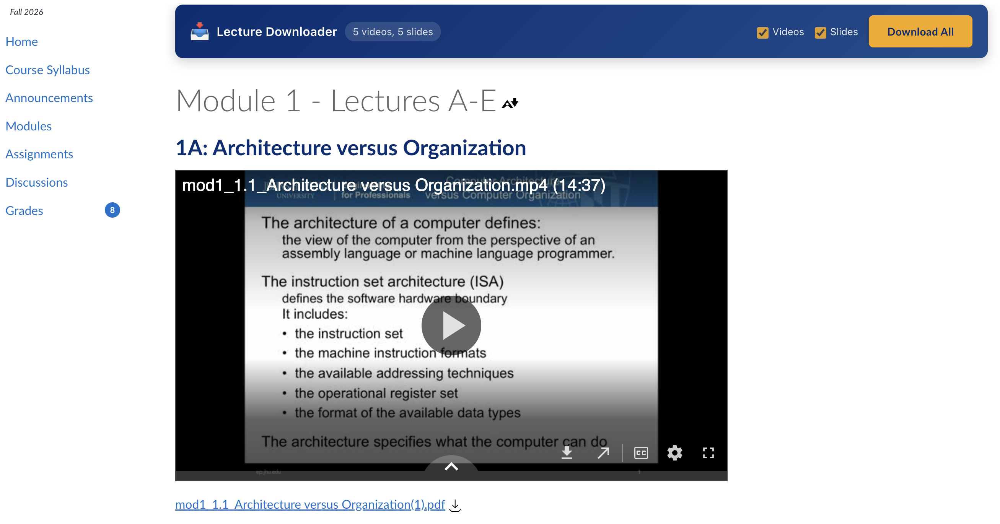

# Canvas Lecture Downloader

A Manifest V3 browser extension that adds a **Download All** bar to Canvas
course content. It finds Panopto lecture videos and PDF slides, lets you choose
videos, slides, or both, and saves them in a folder named after the module or
page inside your browser's downloads directory.

Originally built for JHU, it now detects Canvas and Panopto sites automatically,
including custom university domains. No university addresses or settings need
to be entered.



This project was vibe-coded with AI assistance to make downloading course
materials less tedious. It is a small personal tool, and Canvas or Panopto
changes may require fixes.

## Install

No build step or package manager is required. After cloning or checking out this
repository into a permanent local folder:

1. Open your browser's extensions page: `chrome://extensions` for Chrome or
   Chromium, `brave://extensions` for Brave, or `edge://extensions` for Edge.
2. Enable **Developer mode**.
3. Click **Load unpacked** and select the repository folder containing
   `manifest.json`.
4. Sign in to your university's Canvas and Panopto sites as usual, then open or
   refresh a Canvas course page containing lectures or PDF slides.

Keep the repository folder in place; the browser loads the extension from it.
After pulling changes, reload the extension on the extensions page and refresh
Canvas. If the browser removes the installation after an update, repeat
**Load unpacked**.

## Use and supported content

Select **Videos**, **Slides**, or both, then click **Download All**. The bar
appears only when supported materials are found on a recognized Canvas course
or file page, and updates when content loads dynamically.

For Panopto videos embedded in Canvas, you often need to click **Sign in** in
the Panopto player first, even if you are already signed in to Canvas. Once the
video loads, click **Download All**; if a previous attempt failed, refresh the
page and retry.

- Panopto embeds and direct player links, including custom domains, multiple
  Panopto sites on one page, and links containing an embedded player URL.
- Canvas PDF file links, including links whose labels do not include `.pdf`
  when the authenticated Canvas Files API identifies them as PDFs.
- Direct PDF links hosted outside Canvas.

Download addresses come from the current Canvas site, the original file link,
or each video's Panopto player address. The extension uses your existing login
and preserves file access parameters. Duplicate links are combined, while files
with the same name get unique download filenames.

Only materials on the current page are scanned; the extension does not crawl
an entire course. Opaque LTI launch links without a player URL, other video
platforms, and recordings exposing only adaptive streaming manifests are not
currently supported. University download restrictions still apply.

Check your browser's downloads list to confirm files finish downloading; the
extension reports download initiation rather than completed transfers.

## Site permissions

Automatic support for custom Canvas and Panopto domains requires HTTP and HTTPS
host access across sites. The content script is limited to course and file URL
paths and checks for Canvas before scanning or showing controls. It does not
require per-university configuration or runtime permission requests.

## Account privacy

No account identifiers, passwords, cookies, or personal browser profile paths
are bundled with the extension. Authenticated requests use each user's existing
browser-managed login; the extension does not read or export cookies. File access
parameters discovered on the current page are used at runtime for the requested
downloads. Verifier values in the regression tests are synthetic fixtures.

## Development

The extension uses plain JavaScript and Manifest V3. Check syntax and run the
background regression checks with Node.js:

```sh
node --check content.js
node --check background.js
node test.js
```

The regression checks cover multiple Panopto hosts, partial failures, temporary
tab cleanup, stream URLs, and download filename handling using mocked browser
APIs. They do not verify authenticated university downloads. For manual testing,
reload the extension, refresh Canvas, and check pages with videos, PDFs, both,
and neither.

Run `node test-browser.js` for headless DOM and URL checks using local fixture
pages and a temporary profile. This defaults to Google Chrome on macOS; set
`CANVAS_TEST_BROWSER` to a compatible Chromium browser executable elsewhere.
The browser must support the DevTools `Extensions.loadUnpacked` command.
The test does not use your personal browser profile.
